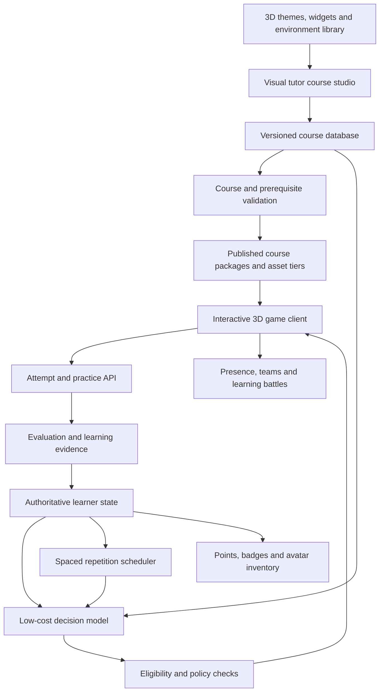

# Amamihe Architecture

## Vision and Status

Amamihe is an indie-style human-simulation learning game set in a persistent 3D venture world. Players grow through demonstrated skills, discover courses as houses along shared streets, and enter tutor-designed adventures. Avatars, outfits, course cities, search portals, other learners, and world institutions make learning a lived game experience. The 3D world is a core requirement at every graphics quality setting.

Implementation status: the browser game is deployed over HTTPS at [amamihe.online](https://amamihe.online). Versioned course authoring, post-clearance mock assessment, individual rewards, isolated practice tools, recall, bounded shared rooms and team battles, search portals, moderated billboards, and Learning Police are implemented. The six-level storytelling pilot is published at the default learner entrance. The corrective adventure implementation adds articulated action rigs, traversable scenes, server-authoritative collisions and checkpoint recovery, but final browser validation and deployment are pending; see [handoff and unresolved errors](docs/status/ADVENTURE_HANDOFF.md) and [adventure runtime](docs/status/ADVENTURE_RUNTIME.md). Physical 2 GB-device validation, final artwork acceptance, learning outcomes, and live classification accuracy remain evaluation gates. Teaching material remains tutor-authored.

## Venture World and Player Journey

### Identity, Avatars, and Skill Economy

Registration includes avatar and starter-outfit selection from free presets. An account is not permanently classified as learner or tutor: any player can consume courses, create courses, or do both. Course publishing still requires validation, ownership checks, and resource review.

Demonstrated skill is the world's principal measure of growth and opportunity. Maintain a non-spendable, concept-specific skill profile separately from spendable in-game points and owned gear. Skill achievements can earn points, badges, and outfit unlocks; spending points must never remove learning evidence. Gear changes remain available through inventory within earned resources. No real-money purchases are required by the prototype.

### Streets, Course Houses, and Enrollment

Course feeds are explorable streets in themed course cities. Each house represents a published course version; its doorway presents title, tutor, objectives, prerequisites, language, expected effort, preview, and available runtime/resources. Deliberately entering/enrolling starts the course adventure; accidental movement through a doorway must not silently enroll the player. Returning learners can resume from a saved checkpoint.

Use stable course IDs and separate house/door placement from course content. Streets can contain paginated or sharded sets of houses rather than loading the entire catalogue. All players discover the same logical catalogue even when capacity requires different city instances. Walking the city remains the default discovery experience.

### Search Portal Universe

Players invoke a portal, enter search terms, and travel to a separate search-result universe. Result portals each lead to a course's doorstep and display its preview before the player decides to enroll. Search uses course metadata and indexed tutor-authored descriptions; it does not require generated course content.

Support filtering by subject, language, prerequisites, available practice tools, and resource needs. Preserve the originating city location, preview selection, and return route. Load a bounded batch of result portals; empty and failed searches leave an obvious way back.

### Shared Adventures and Presence

Players see and interact with others in the same city or course adventure in real time. Match course presence by course version and compatible story checkpoint so one player's progress does not overwrite another's. Group participation and collaboration are configurable, while individual assessments retain independent evidence and assistance records.

Use interest-managed, capacity-limited rooms, low-frequency presence updates, and interpolated avatar movement. Do not stream the entire city's player population to a 2 GB client. Social behavior, previews, account identities, and moderation are server-authorized. Invitation-only rooms remain an initial rollout limit; broader streets and course populations follow tested capacity.

### Authorized Billboards

Support user-submitted billboard advertisements in city streets and tutor-configured billboard placements within course adventures. A submission records owner, approved creative, destination, placement, audience restrictions, review status, and active dates. Publishing rights for a course do not imply authority to place ads in public streets.

Moderation must approve ads before display. Mark them clearly as ads, validate links and asset sizes, and prohibit creatives from acting as grading instructions. Use static, compressed creatives first; ads must not block doors, interrupt graded tasks, or exhaust the asset budget. The prototype uses in-game or administrator-granted placements, not a purchased ad service or a real-money marketplace.

### Learning Police and World Rules

Learning Police are NPCs enforcing a configurable learning-engagement policy. Meaningful participation includes a course adventure, practice task, course authoring, or constructive learning collaboration. Mere movement does not reset the idle timer. Track server-confirmed activity signals, not only button presses.

Use explicit states: `active → warning → arrested → temporarily_evicted → eligible_for_release`. An arrest opens an in-game notice explaining the rule and available release options. Temporary eviction removes the player from unrestricted roaming, preserving course progress and earned skills. A release area offers either an in-game point fine or completion of a bounded, goal-aligned learning task/course. A player without points must have a no-purchase learning-release path.

Idle thresholds, grace periods, fine limits, and eviction duration are configurable policies, not hard-coded universal values. Publish them before enforcement. Pause timers for legitimate loading, lost connectivity, suspended tabs, declared breaks, approved accessibility adjustments, and pending assessment/tool responses. Allow enough discovery time to inspect courses and use search; choosing a course is part of the journey. Support an appeal for false arrests and prevent duplicate fines or penalties.

NPCs present enforcement; a deterministic server policy decides it. The classification model may identify appropriate release learning from approved resources, but cannot invent offenses or impose unbounded punishment. Eviction must not erase mastery, seize earned badges, charge real money, or require a paid course to regain access.

### Additional World Records

Add `AvatarProfile`, `GearInventory`, `CityInstance`, `HousePlacement`, `Enrollment`, `PresenceRoom`, `SearchPortalSession`, `BillboardSubmission`, `BillboardPlacement`, `WorldRuleVersion`, `EngagementEvent`, `EnforcementCase`, and `ReleaseTask`. Link penalties and fines to a versioned policy and transaction record. Retain audit evidence without collecting raw continuous surveillance unnecessarily.

## System Boundaries

The browser renders the world locally. Backend services own confirmed mastery, schedules, reward balances, inventories, and team results. The decision model can recommend eligible content identifiers; it cannot bypass prerequisites, publish content, grant mastery, or award points directly.

## Visual Course Studio and Course Storage

The Step 2 implementation uses a React node-and-connection editor with keyboard-accessible ordering and preset selectors, plus a Babylon.js scenery/task preview. Creator-owned drafts and immutable course versions are stored as bounded, validated JSONB documents; ownership, snapshot references, enrollments, and response evidence have relational constraints. This keeps the initial prototype compact while preserving a future normalization path for larger content banks. [Course authoring](docs/authoring/COURSES.md) documents the implemented API and version rules. Step 3 adds persisted criterion grades, compact validated routing, and pending recovery; Step 4 binds task events to chase, foot-racing, and sparring scenes with server-clock section timing, step-only retries, badges, and a transactional cosmetic ledger. See [learning engine status](docs/status/STEP_03_STATUS.md) and [adventure status](docs/status/STEP_04_STATUS.md). Adaptive assets, isolated practice tools, version-pinned recall encounters and bounded shared presence now extend this baseline; see the Step 5–8 status documents. Rich drag editing and broader world authoring remain extensions.

Tutors build courses through an interactive editor, not a raw JSON/YAML requirement or a long configuration form. The studio should provide:

- A visual story and prerequisite map with draggable levels, branches, and review encounters.
- A library of predefined 3D story themes, rooms, widgets, NPC interactions, and challenge components.
- Resource uploads and reusable banks of baseline questions, challenges, hints, explainers, and independent retry alternatives.
- Editors for objectives, rubrics, difficulty, prerequisites, rewards, and practice-environment bindings.
- An in-world preview that lets the tutor simulate a learner path before publishing.

A database stores the course structure and resources. A manifest is an internal versioned representation or optional import/export format, not the tutor-facing authoring experience. The concept prerequisite graph remains a DAG; the story may branch, revisit rooms, and repeat encounters without creating cycles in that prerequisite graph.

Proposed entities include `CourseVersion`, `Concept`, `StoryLevel`, `Resource`, `Question`, `Hint`, `Explainer`, `Rubric`, `RetryVariant`, `SceneTemplate`, `WidgetBinding`, and `PracticeEnvironmentBinding`. Link questions and resources to stable identifiers, concepts, difficulty, supported languages, and source references. Record learner goals, attempts, assistance, evaluations, mastery, review items, decision reasons, and Codex entries separately from course content.

Before publication, validate missing references, duplicate IDs, prerequisite cycles, widget compatibility, source attribution, and coverage of every reachable learning step. Each assessed concept needs suitable questions, help, and independent retry material. Missing coverage must be reported to the tutor rather than silently filled by runtime generation. Published versions are immutable; existing attempts retain their course, rubric, question, and scene versions.

## Classification Model and Evaluation

The model receives compact learner evidence and a bounded set of eligible question, resource, hint, explainer, or level IDs. It returns a structured selection and reason. Eligibility is computed from prerequisites, mastery, assistance history, review due dates, resource availability, and the tutor's configured trajectory.

Use a classification/decision model to select approved activity identifiers from structured learner evidence. It grades bounded question or interaction chunks against tutor-authored rubrics, then selects approved next activities from aggregated evidence. It does not create instructional content. Route requests through a backend adapter to a verified no-charge model endpoint on OpenRouter. No model weights are downloaded to learner devices. Cached deterministic routes can continue supported activities without connectivity; remote practice tools and live multiplayer remain network-dependent.

Tutors provide assessment rubrics, answer keys, and executable test cases where appropriate. Use deterministic grading for objective answers, spatial constraints, and coding tests. Use the classification/decision model for in-game rubric grading, with deterministic answer/test evidence where available. Calibrate its scores against tutor-reviewed examples before using them for progression. Tutor review handles ambiguous or contested outcomes rather than every routine answer. Uncertain or unavailable assessment stays pending and cannot grant mastery.

## Pedagogical Responsibilities

The ten teaching roles remain functions of the learning system rather than ten content-generating agents.

| Role                | Implementation in the authored-content approach                                        |
| ------------------- | -------------------------------------------------------------------------------------- |
| Mapmaker            | Validate the tutor's concept graph and bind it to story levels.                        |
| Interviewer         | Select tutor-authored baseline questions and goal prompts.                             |
| Socratic Questioner | Select graduated, predefined reasoning prompts.                                        |
| Explainer           | Present a tutor-authored explanation suited to the concept and learner level.          |
| Examiner            | Select questions and challenges from approved difficulty banks.                        |
| Checker             | Evaluate intermediate work and final answers using configured criteria.                |
| Listener            | Capture text, optional speech transcripts, and spatial submissions for assessment.     |
| Diagnostician       | Match recurring errors to tutor-defined misconceptions and prerequisite resources.     |
| Sparring Partner    | Run configured practice encounters and learning battles.                               |
| Clerk               | Assemble progress and takeaways from recorded evidence and approved summary templates. |

## Learning Loop and Story Progression

1. Select baseline questions, establish goals, and choose an eligible starting level.
2. Present an authored active-production challenge through its configured 3D widget or practice environment.
3. Record intermediate work and whether hints or explanations were used.
4. On a qualifying independent pass, update mastery evidence, story progression, rewards, and review scheduling.
5. On difficulty, select a predefined Socratic prompt. Self-correction returns to the appropriate step with assistance still recorded.
6. After explanation or a revealed solution, require a full independent retry using another authored question or a tutor-approved parameterized variant. Selection and bounded parameter substitution do not require model-generated content.
7. When errors recur, route to an appropriate prerequisite encounter. If the bank lacks a valid retry, report the gap instead of granting mastery or inventing a challenge.

Story levels provide satisfying milestones through world changes, avatar progression, and celebrations tied to actual learning. Visual story progress, activity participation, and concept mastery are distinct records. Accessibility settings, reduced graphics, and language choices do not count as pedagogical assistance.

Success above 85% and failure above 40% remain tunable initial adaptation proposals. Define sample windows, minimum evidence, and escalation limits before enabling them. Choose FSRS or SM-2 behind a scheduler interface; example intervals are illustrative rather than a fixed FSRS schedule. Due reviews become authored encounters selected from the course bank.

## Genuine 3D World and Adaptive Quality

Use a real 3D scene, spatial movement, camera, avatar, and interactive geometry. Tutors compose predefined themes and components into story paths; they need not model assets or program scenes. Choose one browser engine, such as Three.js or Babylon.js, after a prototype validates rendering and interaction needs.

Offer manual and automatic quality presets with familiar labels such as 144p, 360p, 720p, and 1080p. Define each as a target internal render height at the current aspect ratio, subject to device limits. Keep text and controls legible independently of the scene's render resolution.

Lower resolution reduces GPU work; it does not inherently reduce downloaded asset bytes in a locally rendered game. Bandwidth adaptation therefore also selects compressed texture and mesh tiers, levels of detail, audio quality, staged downloads, and caching. Runtime performance controls render scale, lighting, shadows, effects, and frame-rate targets. Connectivity measurements control asset delivery. Every preset preserves the 3D world, challenge semantics, and mastery criteria.

Load the current level's essentials first and prefetch cautiously. Cache reusable components and course packages where supported. Save interrupted work and synchronize without duplicating attempts or rewards. Offline capability must be declared per activity; hosted inference, remote practice kernels, and live multiplayer can still require connectivity.

## Tutor-Configured Gameplay Themes

Course adventures are built in the visual studio from preset themes, section templates, task banks, and approved resources. Tutors configure task-to-action bindings, section deadlines, point rules, checkpoints, failure animations, and step-level retries. The same concept graph can be presented through different gameplay themes without changing its learning criteria.

| Preset       | Learning-to-game binding                                                                                                       | Failure and progression                                                                                                                                               |
| ------------ | ------------------------------------------------------------------------------------------------------------------------------ | --------------------------------------------------------------------------------------------------------------------------------------------------------------------- |
| Temple chase | Completing authored tasks within their allotted section time keeps the avatar ahead of pursuing monsters and clears obstacles. | Exceeding the active section deadline triggers a monster catch or obstacle collision and Game Over. Retry that specific step, preserving prior completed checkpoints. |
| Racing       | Correct, faster task completion grants bounded speed boosts and advances the avatar along a track.                             | Tutor-defined minimum completion criteria and timers determine checkpoint clearance or step retry. Speed alone does not prove mastery.                                |
| Wrestling    | Correct, faster task completion produces more effective avatar punches or combos against a fictional game opponent.            | Task outcomes and configured match rules determine level clearance and step retry. Keep action stylized and non-graphic.                                              |

These are preset behaviors, not demands that tutors program a game. Preview must demonstrate deadlines, point awards, task widgets, and failure/retry behavior before publication. Tutoring content never needs to be generated during play.

### Runtime and Classification Checkpoint

Use two separate control loops. The deterministic game loop maps validated task events to movement, boosts, attacks, points, and local level progression. The classification checkpoint runs only once the player has cleared the level: bounded assessments grade accumulated chunks, then a compact aggregate determines the next level and tutor-authored task set.

For objective tasks, answer keys and executable checks can drive immediate gameplay feedback. An open-ended task without a reliable deterministic in-level evaluator may provisionally record completion and reserve substantive grading for the checkpoint; completing the game level is not yet a mastery claim. Tutors must declare those semantics and avoid awarding correctness rewards for ungraded text. Pending checkpoint assessment shows a neutral waiting state, stops course deadlines, and cannot count as idle-world misconduct.

A timed Game Over restarts the failed step, not the whole course, and never calls the classifier merely to impose failure. Keep tutor-authored help and independent retry records. Deadlines count active task time rather than downloads, network delays, tool startup, or waiting for classification. Store accommodation-adjusted timing separately so speed effects do not misclassify accessibility settings as assistance. Slow-paced rendering on 2 GB devices must not require reflex-perfect avatar control; learning-task completion drives the action.

## Embedded Practice Environments

Embed learning tools as resources within the game: a notebook workstation, JavaScript coding terminal, drawing canvas, or a compatible external tool. Offer reusable environment adapters that tutors select and configure in the studio. Preserve course, level, learner, and attempt context when entering or leaving a tool.

Each adapter declares supported actions, submission format, connectivity needs, and evaluation capabilities. External tools may reject embedding through frame or content-security policies; support only verified integrations and provide an explicit launch-and-return path for those that cannot embed. Do not imply that opening an external page captures learning evidence automatically.

Run learner code in isolated browser runtimes or restricted server sandboxes, never in the application server process. Enforce compute, memory, execution-time, file, and network limits. Validate iframe origins and message contracts; separate tool credentials and learner data from the game client. Hosted notebooks and browser-local environments have different cost and offline characteristics that must be measured.

## Incentives and Social Play

Award points and badges for defined learning achievements. Points can purchase configured avatar gear; inventories and transactions use an authoritative, idempotent ledger. Cosmetic progression must not alter grading or let learners purchase mastery. Real-money trading is not assumed.

Provide learner presence, social interaction, team creation and joining, and learning battles between teams. Team challenges may combine individual tasks and cooperative objectives. Publish scoring and reward rules; distinguish shared team rewards from individual mastery evidence. Reconnect handling, server-validated outcomes, and duplicate-reward prevention are required. Team prizes are configurable; funding or external fulfilment is not presumed.

Support solo progression alongside social play. Define communication permissions, blocking/reporting, moderation, and age-appropriate defaults before exposing interactions. Avoid broadcasting academic weaknesses through public profiles. Live multiplayer is a separate connectivity demand and cannot be promised at every bandwidth setting.

## Recommended Technical Baseline

The React/TypeScript, Babylon.js, Fastify, and PostgreSQL foundation is implemented and deployed. Course authoring, mock assessment, task-driven adventures, and cosmetic rewards are verified. Adaptive rendering, isolated practice workspaces, conservative FSRS scheduling, opt-in eight-player rooms and consented asynchronous team battles are implemented. The status documents distinguish working behavior from remaining integration and evaluation targets. Live OpenRouter classification is deferred. See [foundation status](docs/status/STEP_01_STATUS.md) and [hosting configuration](docs/deployment/HOSTING.md) for verified implementation boundaries.

| Area                | Recommendation                                                                                             | Rationale                                                                                                                                                                          |
| ------------------- | ---------------------------------------------------------------------------------------------------------- | ---------------------------------------------------------------------------------------------------------------------------------------------------------------------------------- |
| Frontend            | React, TypeScript, and Vite                                                                                | One application can support the course studio and game shell; keep the render loop outside React state updates.                                                                    |
| 3D engine           | Babylon.js with WebGL 2 as the baseline                                                                    | Integrated scene, camera, picking, animation, and asset tooling reduce custom game infrastructure. WebGPU is an optional enhancement.                                              |
| Visual editor       | React Flow plus an in-engine preview                                                                       | Reusable node editing for concept/story paths, with preview using the same runtime as the published course.                                                                        |
| Backend             | Node.js LTS, TypeScript, and Fastify                                                                       | A modular API supports authoring, attempts, rewards, and WebSockets without an initial microservice fleet.                                                                         |
| Database            | PostgreSQL                                                                                                 | Transactions protect progression and reward integrity; relational references support versioned course structure. Use JSONB for validated widget settings, not all relationships.   |
| Assets              | Versioned compressed files on existing infrastructure; optional verified free static hosting               | Avoid purchased storage/CDN services; keep the delivery interface replaceable.                                                                                                     |
| Hosting             | Render Free application service and Neon Free PostgreSQL for the preview                                   | Same-origin client/API delivery and durable progress without a paid disk. Idle suspension and quotas limit this to a bounded pilot; account access is still needed for deployment. |
| Decision model      | Decision-only LLM through a verified no-purchase OpenRouter classification endpoint                        | Select approved IDs using compact context and strict response validation; chunk-level rubric grading and route selection; no instructional generation.                             |
| Inference placement | Remote free endpoint behind the backend; cached decisions and deterministic fallback routes                | Keep inference off 2 GB devices. Fallback rules are resilience measures, not a replacement for the classification/decision model.                                                  |
| Open-ended grading  | Decision-LLM rubric scoring per question/interaction chunk                                                 | Store scores and evidence; aggregate compact results for routing. Deterministic checks corroborate applicable answers and tutor review resolves uncertainty.                       |
| Review scheduler    | `ts-fsrs` behind a versioned scheduling adapter                                                            | Fits the TypeScript stack and isolates scheduler changes from course/game logic.                                                                                                   |
| Python practice     | Notebook adapter with an existing shared Python/PyTorch runtime or an available no-charge notebook service | Keep model training separate from the 3D client. Browser-local tools remain optional for small exercises after memory testing.                                                     |
| Social transport    | WebSockets through the API for small rooms                                                                 | Sufficient for a limited presence and team-battle prototype; scale services only after measured demand.                                                                            |

### Decision Policy and Learning Evidence

Send only compact learning state, eligible content IDs, difficulty tags, and recent error/assistance summaries. Use separate schema-validated grading and routing responses: a chunk assessment records criterion scores and evidence; a stage-route decision returns an eligible next-step ID and a bounded reason code. Prerequisites, mastery, rewards, and review scheduling remain deterministic backend responsibilities.

Select the exact endpoint from the provider's current free-model catalogue during implementation. Benchmark routing accuracy, response schema compliance, latency, privacy terms, and quota limits; model availability and free access must not be assumed from a historical model name. The routing adapter must support replacing providers without changing courses. Cache suitable decisions and limit calls to meaningful learning transitions rather than frame updates or every click.

Only the classification/decision model is permitted as an operational LLM. Tutor-authored content and chunk-level classification-model grading form the baseline. The small storytelling model trained within the course is a learning artifact, not an additional platform tutor or grading model. If no no-charge endpoint or existing local inference host is usable, classification-model validation is blocked; deterministic fallback alone does not establish completion of that requirement.

### Chunked Grading and Stage Decisions

1. During a level, capture each question/interaction chunk and its rubric, response, assistance flags, timing, and deterministic evidence. After level clearance, submit those chunks individually for classification grading; do not send the entire course or full transcript.
2. Validate and store a structured assessment with `attempt_id`, `chunk_id`, criterion scores, concise evidence references, misconception tags, uncertainty flags, rubric version, model/provider identity, and evaluation status. Scores must remain within rubric bounds. Model-reported confidence is not proof of reliability.
3. Aggregate validated results deterministically by concept and criterion, retaining independent-versus-assisted distinctions, failures, pending outcomes, and compact error patterns. Do not reduce the entire exam to an average that hides a critical prerequisite gap.
4. Only after the player clears the level, run the classification checkpoint. Grade the stored question/interaction chunks in bounded calls, aggregate them, and submit the compact summary plus eligible next-level/task-set IDs for route classification. Preserve the full evidence without sending it all at once. Before clearance, deterministic mechanics handle task feedback, authored help, timers, and step retries; the classifier does not interrupt gameplay to choose a new path.
5. Apply backend progression constraints and persist the accepted route and its reason. Pending critical assessments prevent premature mastery; retries cannot duplicate evaluations or rewards.

Assign token budgets per provider/model, reserve output capacity, and split long submissions at rubric-aligned boundaries with shared identifiers. Never silently truncate an answer or relevant grading criterion. Summarize completed sub-assessments through deterministic aggregation; retain original evidence for audits and targeted rechecks. Large responses can use hierarchical chunk summaries without requiring the model to consume the entire stage at once.

Assess a completed question or meaningful event group rather than every keystroke, render frame, or raw mouse event. Cache assessments only for identical versioned inputs and limit retries. This keeps context bounded while making the cost and free-request quota visible: an exam with ten graded questions generally needs at least ten grading calls plus a routing call.

### OpenRouter Model Assessment

Provider choice: OpenRouter. The public `/api/v1/models` catalogue was inspected on 2026-10-08; catalogue evidence is not an authenticated inference or grading benchmark.

| Catalogue finding                         | Relevance and limit                                                                                                                                                                                                                                     |
| ----------------------------------------- | ------------------------------------------------------------------------------------------------------------------------------------------------------------------------------------------------------------------------------------------------------- |
| `typesafe/jev-router`                     | Described as using Jev to choose a downstream model and reasoning effort. This does not establish an educational classification/scoring API. Prompt/completion pricing fields are `-1`, so no fixed price comparison or free-access claim is justified. |
| `liquid/lfm-2.5-2.6b:free`                | Listed with zero input/output token prices and structured-output support. It is a general-purpose reasoning model, not a verified Jev-style classifier; it is not the selected substitute.                                                              |
| `nvidia/nemotron-3.5-content-safety:free` | Listed with zero token prices, but specialized in content safety. It does not establish suitability for grading subject knowledge or choosing pedagogy.                                                                                                 |

The official Jev guide was subsequently verified on 2026-10-11. OpenRouter exposes `POST /api/alpha/decisions` with typed `choice`, `noul` and `score` questions for `typesafe/jev-1.13`. The server adapter uses question-sized choice classification and a separate aggregate routing request; it never calls chat completions. Published input pricing is $0.042 per million tokens, with zero output-token price. This is not free: production remains mock while the private key and an explicitly authorized nonzero budget are absent. No cheaper free purpose-built equivalent has been verified. A general chat model that emits JSON is not automatically an equivalent classifier. Do not silently route through paid models or call a model router a grading model.

The typed provider adapter validates provenance, confidence, bounded input/output and authored identifiers, and records pending results on failure. Tutor-scored calibration and authenticated live endpoint verification remain external acceptance gates. Keep provider/model identity, calibration version, typed outputs, and pending statuses in the assessment store.

Use Google Colab free notebooks for the training-course integration, with Kaggle or existing shared compute as alternatives. Session/account restrictions and free GPU availability still require testing. Use launch-and-return when embedding is prohibited. These training tools do not change the OpenRouter requirement for operational classification.

Sources: [OpenRouter model catalogue](https://openrouter.ai/api/v1/models), [Jev typed decision guide](https://openrouter.ai/docs/guides/community/jev), [API tutorial](https://openrouter.ai/docs/guides/community/jev-tutorial). No authenticated model request was made.

### No-Purchase Prototype Constraint

Use open-source tools, existing machines, and verified free services. No purchased API credits, subscriptions, managed databases, GPUs, domains, storage, or hosting are required by the prototype baseline. Credentials for free access may still be necessary; enter them through secure configuration and never embed them in the client.

Do not enable paid fallback routes, automatic top-ups, or billable resources. Document free-tier quotas and outages, and stop or use supported cached routes when a limit is reached. Public hosting uses the existing Contabo VPS and Cloudflare-managed domain. Shared training compute remains conditional on actual available free resources. Free hosted inference is not a guarantee of continuous or offline operation.

### Initial Theme and Curriculum

Start with **Venture City**: a compact walkable learning neighborhood with course houses, a portal plaza, a creator workshop, authorized billboard slots, and a Learning Police release area. Use **Model Makers Workshop** as the initial course-house adventure where learners build their storytelling model. Reuse a small asset set across three to five story levels. Include an avatar, NPC/resource stations, spatial interaction, and visible changes after milestones. Skill-earned outfit upgrades reinforce growth across courses.

Use **Train a 1M-Parameter Storytelling Language Model from Scratch** as the pilot curriculum. Target learners with basic Python knowledge; include diagnostic and remedial banks rather than assuming prior machine-learning expertise.

Structure the learning path around data provenance and preparation, tokenization, causal prediction, a small decoder-only Transformer, parameter counting, training/validation splits, optimization, loss curves, sampling, and error analysis. Tutor-authored notebooks and retries progressively require learners to implement and explain these parts, culminating in training and evaluating a model.

A candidate uses a 256-token byte vocabulary, context length 128, model width 128, four blocks, four attention heads, feed-forward width 512, and tied input/output embeddings. This is approximately 0.84M parameters with conventional biased linear layers and learned position embeddings; count the actual implementation and adjust to an agreed tolerance around 1M. Train initialized weights from scratch rather than fine-tuning a pretrained model.

Use a small, legally reusable or tutor-authored story corpus with a held-out split and recorded provenance. Assess correct implementation, reproducibility, learning curves, and honest limitations; a model this small is not expected to produce polished storytelling. The final task should distinguish memorization from generalization and compare sampling settings.

Run full training on an existing shared machine or an available free notebook runtime. CPU training may be slow and free GPU sessions may be unavailable. Use short learner-run experiments, checkpoints, and tutor-provided reference runs without presenting reference outputs as learner training. A 2 GB phone/laptop is the game-and-notebook access target, not a promise that it can concurrently render the world and train the model. Pause or reduce game rendering while a practice tool is open.

### Target Devices and Performance Budgets

Use a provisional baseline of an Android phone with 2 GB total RAM and a laptop with 2 GB total RAM, using a compatible browser and tested graphics driver. Select actual reference devices and test browsers before making compatibility claims. Browser runtime memory and graphics support matter beyond RAM alone.

Proposed acceptance targets, to be verified on those devices:

- Target 10–15 FPS for the low-quality scene on reference 2 GB devices, with a configurable cap and responsive, readable controls. Use slow-paced interactions rather than reflex-sensitive combat. This is an unverified budget, not a compatibility claim.
- No more than 3 MB compressed transfer for the application shell and smallest first playable scene. Treat this as an asset-budget constraint; measure it early and revise scope if necessary.
- First playable scene within 30 seconds on a controlled 2 Mbps connection, including transfer, parsing, and initialization.
- Cached return to the first scene within 5 seconds on the reference device.
- Decision API processing p95 below 100 ms and learner-visible routing below 1 second on the pilot connection.
- No paid inference calls or purchased services. Measure free-endpoint latency separately from local API processing.
- Provisional game-tab memory budget: no more than 250 MB measured on the reference devices. Report measurement method; include GPU memory where tooling exposes it and test browser/OS termination under pressure.

Report practice-tool transfers separately; do not preload training frameworks into the game tab. Verify notebook access and shared training availability independently. Quality labels do not promise identical frame rates or universal connectivity. Instrument cold/warm loading and download sizes rather than relying on nominal render resolution.

### Initial Social Scope

Demonstrate invite-only rooms with up to eight learners and battles between two teams of up to four members. Use discrete, turn-based or asynchronous learning tasks rather than continuous physics-dependent combat. Presence updates can be low-frequency; movement interpolation keeps the world responsive while results remain authoritative.

Offer solo progression and a cooperative/battle room using the same 3D assets. Begin with preset communication phrases, private invites, blocking/reporting, and a facilitator moderation workflow; unrestricted chat and public matchmaking can follow after moderation requirements are met. These limits are prototype targets, not proven capacity. Team prizes initially use in-game points, badges, and cosmetic items.

### Decisions Requiring Pilot Evidence

Hosting region, actual device floor, adaptation windows, target age group, additional languages, reward amounts, retention periods, and broader social rollout require audience research or measured results. The baseline does not remove practice environments or team play from the product roadmap.

See [IMPLEMENTATION_PLAN.md](IMPLEMENTATION_PLAN.md) for delivery order and [RULES.md](RULES.md) for required behavior.

## Classification Interface

Use a classifier/scorer interface rather than a chat-completion dependency. Tutor-authored criteria define allowable outcomes such as `correct`, `partially_correct`, `incorrect`, and `insufficient_evidence`; routing defines eligible actions such as `advance`, `retry`, `explain`, and `review_prerequisite`. Map typed outputs or probability scores to versioned assessment records. Do not require generated rationale prose; retain criterion IDs, outcome codes, and referenced evidence.

A small context window is handled through per-question or rubric-aligned classification calls followed by compact stage aggregation and route classification. Classification accuracy, calibration, ambiguity handling, and available no-purchase deployment determine suitability. Constrained outputs alone do not establish that grades are correct.
