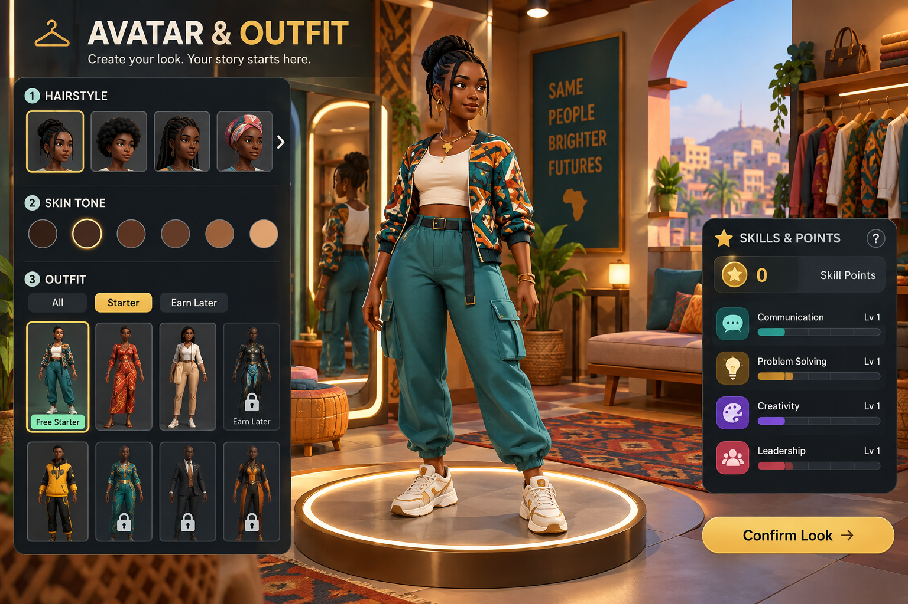
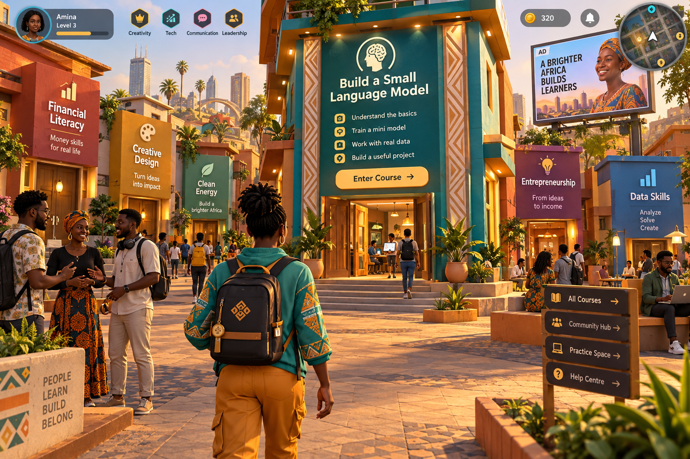
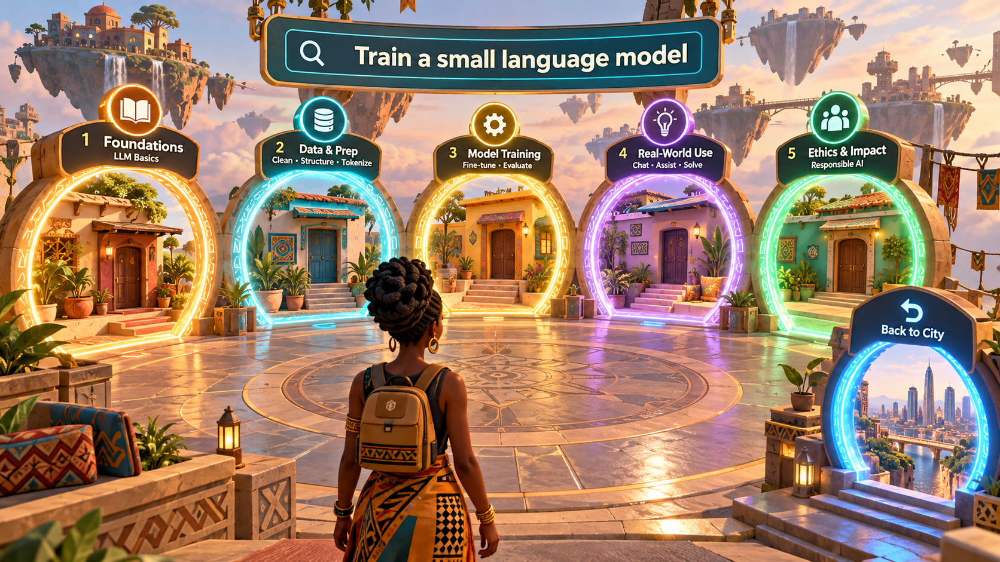
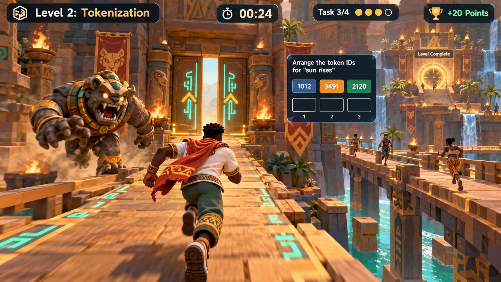
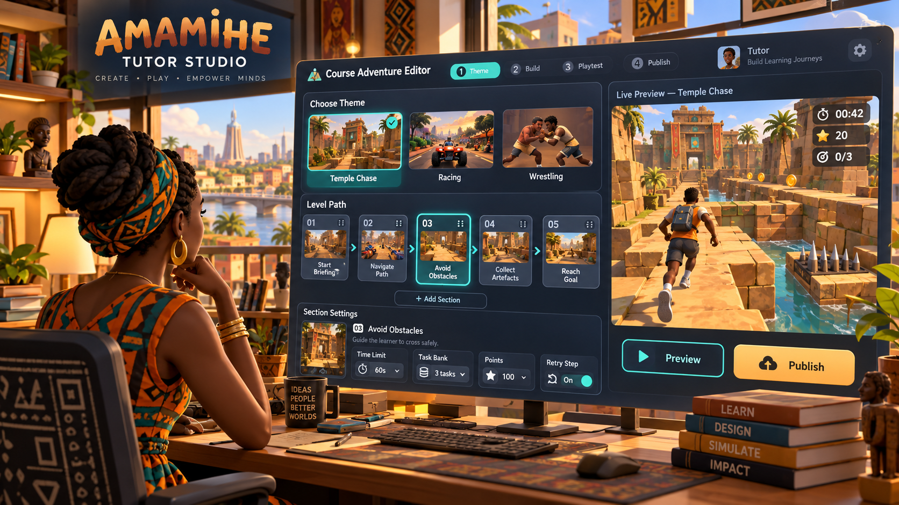
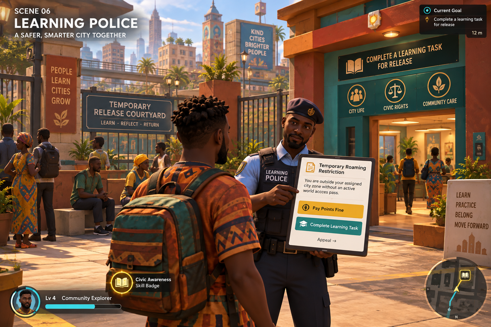

# Venture World Scene Previews

Each scene is a separate concept image for individual review. These are design illustrations, not implemented game screenshots or performance evidence.

## Avatar & Outfit

## Course Streets

## Search Portals

## Course Adventure — Temple Chase

## Tutor Studio

## Learning Police

## Gameplay Direction

Tutors choose presets and configure task banks, deadlines, points, mechanics, and retry checkpoints. Temple Chase turns timely task completion into escape; Racing turns it into speed; Wrestling turns it into stylized attacks. Game Over retries the failed step. Only after level clearance does the classification checkpoint grade recorded chunks and select the next level and authored task set.

The course-adventure image demonstrates Temple Chase. Racing and Wrestling appear as selectable presets in the studio; their standalone gameplay previews can be developed separately. The original six-panel concept board is retained in docs/design/previews/venture-world-concept-board.png for historical comparison.

## Illustration Limits

UI text and example values are illustrative. The avatar image's generic skill levels are not proof of earned mastery; registration grants starter gear, not automatic learning credit. Search results must preview separate courses rather than imply that the five displayed topics necessarily belong to one course. The police notice is a concept preview: enforcement applies to the published engagement policy, not merely being outside an assigned zone. Implementation must follow the technical documents where illustrative text differs.

Review feedback can identify a scene number, then address layout, camera, character design, UI, world density, or gameplay clarity. All implemented scenes must preserve genuine 3D while meeting the 2 GB device and low-quality budgets.

## Current Browser Implementation

The browser game now includes rigged characters with revised clothing, hair, and accessories; varied local residents; stone paving and course-house trim; and a fullscreen HUD. Registration presents starter outfit previews beside the live 3D avatar. These are captures of the running implementation:

- [Avatar studio](../../evidence/screenshots/avatar-studio-current.png)
- [Phone avatar studio](../../evidence/screenshots/avatar-studio-phone-current.png)
- [Narrow-tablet avatar studio](../../evidence/screenshots/avatar-studio-tablet-current.png)
- [Course street](../../evidence/screenshots/course-streets-current.png)
- [Phone street](../../evidence/screenshots/course-streets-phone-current.png)

Residents are local scene characters; these captures do not demonstrate multiplayer. The concept scenes above remain the visual specification. The prototype is stylized, and further architectural detail, material work, and scene density are needed to reach that target. Screenshots do not establish performance on physical 2 GB devices.

On phones and narrow tablets, registration controls move below the avatar preview with a compact outfit selector and a persistent entry button. The game canvas remains fullscreen; movement controls and the city HUD retain their separate responsive layout.
